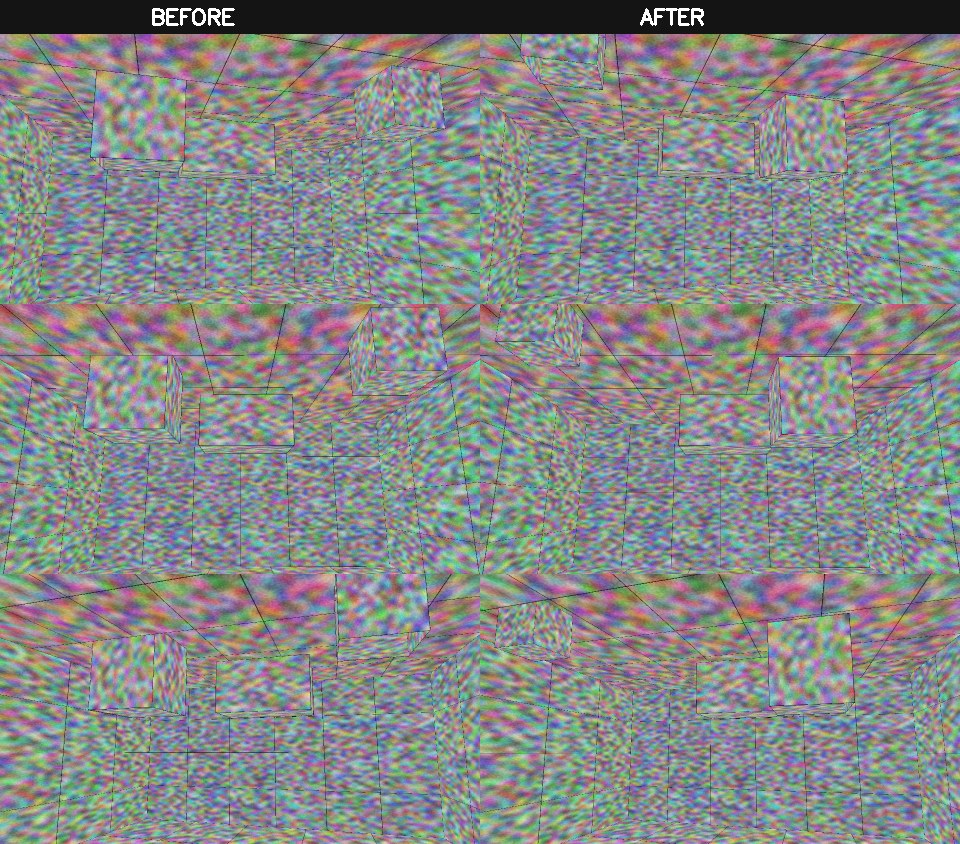
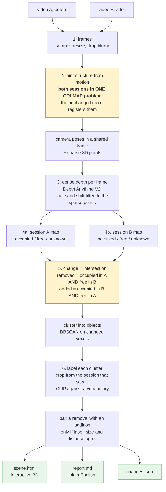
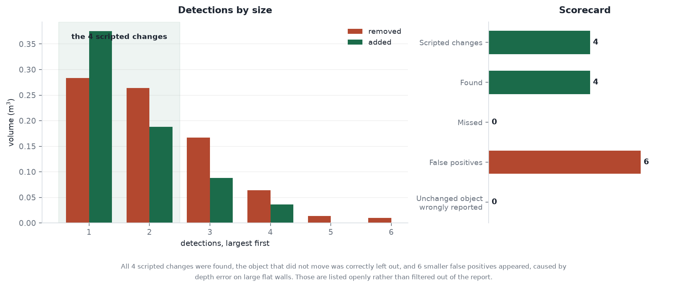
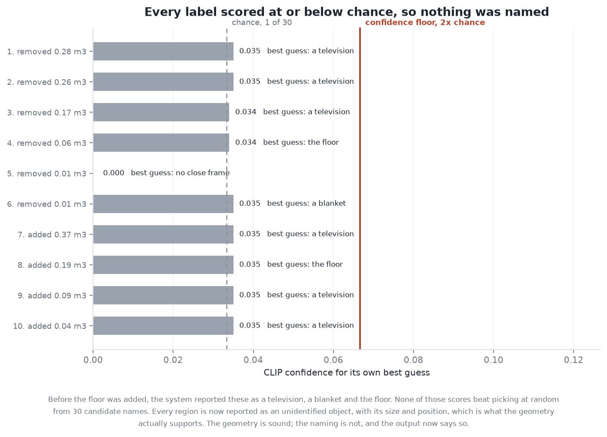
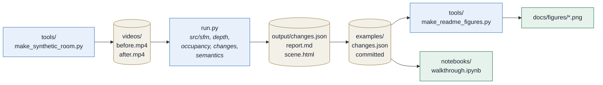

<div align="center">

# What Changed in the Room?

**Two phone videos of the same room, taken at different times. What moved, what
appeared, what is gone, in three dimensions.**

[](https://www.python.org/)
[](https://colmap.github.io/)
[](https://depth-anything-v2.github.io/)
[](https://openai.com/research/clip)
[](#does-it-work)
[](LICENSE)

```bash
python run.py --a videos/before.mp4 --b videos/after.mp4 --out output/
```

An interactive 3D view with the changes picked out, a written summary, and a
JSON file of the findings.

</div>

---

## Contents

[The real problem](#the-problem-is-not-detecting-difference-it-is-detecting-change) ·
[How it works](#how-it-works) ·
[Does it work?](#does-it-work) ·
[What it refuses to say](#what-it-refuses-to-say) ·
[Running it](#running-it) ·
[What it does not do](#what-it-does-not-do) ·
[Layout](#layout)



*Three matching moments from the two recordings used to test the system, before
on the left and after on the right. It is a drawn test room rather than a real
one, for reasons in [Does it work?](#does-it-work).*

---

## The problem is not detecting difference, it is detecting change

Point two cameras at the same room on different days and almost everything looks
different. You stood somewhere else, you held the phone at a different angle,
you walked a different route, things got hidden behind other things.

A system that compares two point clouds will report all of that as change. The
hard part is not noticing that something is different. It is being sure that a
gap means **the object left** rather than **I did not look there this time**.

Two decisions deal with that.

### Both recordings are reconstructed as a single problem

Every frame from both videos goes into one COLMAP reconstruction with exhaustive
matching, rather than reconstructing each video and aligning the results.

The parts of the room that did not change are visible in both recordings, so
COLMAP matches across the session boundary by itself and both sets of camera
poses come out in one coordinate frame. There is no registration step to get
wrong.

This matters because point cloud registration is least reliable exactly when
part of the scene has genuinely moved, which is the only case this project
cares about. Here the unchanged scene does the aligning and the changes are left
as the unknown, which is the right way round.

### Space is tracked as empty, not just as full

Each session is stored as an occupancy map with three states, not a cloud.

| | |
|---|---|
| **occupied** | depth measurements landed here |
| **free** | a camera ray passed through here on its way to a surface, so this space was looked at and there was nothing in it |
| **unknown** | neither, so nothing can be said |

Then change is an intersection rather than a subtraction:

```
removed = occupied in A  AND  free in B
added   = occupied in B  AND  free in A
```

Both sides need positive evidence from the other session. A voxel that was
occupied in A and simply never observed in B produces nothing at all, because
nothing can honestly be claimed about it.


That is the whole argument. It makes the system conservative: it will miss real
changes in parts of the room only one pass covered. That is the right failure
for anything a robot is going to navigate with. Saying "a doorway is clear"
because nobody looked at it is worse than saying nothing.

---

## How it works



The two highlighted steps are the ones that matter. Everything else is
plumbing.

Monocular depth is dense but affine-invariant, so it has no idea of scale. The
sparse COLMAP points are the fix: they are in the same frame from the same
camera, so fitting a scale and shift onto them drops the dense depth into
COLMAP's coordinate system. The fit is done in inverse-depth space, where the
relationship is linear.

A removal is only ever cropped from a **session A** frame, because by session B
the object is not there. Getting that backwards gives you a confident label for
whatever is sitting in that space now, and output that is wrong while looking
entirely reasonable.

Moves are inferred, never assumed. A removal and an addition are reported as one
move only if they share a semantic label, have comparable volume, and sit within
a sensible distance. Anything that does not pair stays an honest removal or
addition.

---

## Does it work?

Tested against a scene where the answer is known in advance.
`tools/make_synthetic_room.py` renders two videos of an imaginary room. Between
them one object moves across the room, one is taken away, one is added, and one
stays exactly where it was. Because the changes are scripted, the output can be
marked rather than admired.



**All four scripted changes were found, and the object that did not move was
correctly left out.** Six smaller false positives also appear, caused by depth
error on large flat walls where the depth model has little to anchor on. They
are in the report rather than filtered out of it.

The volumes are sensible rather than arbitrary. A hollow cube of roughly
0.8 m³ has about 5 m² of surface, and at a five centimetre voxel that is around
0.25 m³ of occupied cells, which is the order of what came back.

<details>
<summary><b>Why the test room looks so strange</b></summary>

It is covered in colourful noise rather than looking realistic, and that is
deliberate. Reconstruction works by recognising the same distinctive patch of
texture in several frames, and a smooth evenly coloured surface gives SIFT
nothing to grip. A photorealistic render would reconstruct badly for reasons
that have nothing to do with the system being tested, and the test would be
measuring the renderer.

The honest limitation is the other side of that coin: CLIP cannot name a cube
covered in coloured noise. The fake room tests the geometry. Only a real room
can test the naming.

</details>

---

## What it refuses to say

This is the part worth reading.



On the synthetic scene CLIP returned confident-sounding labels for every region:
a television, a blanket, the floor. **Not one of those scores beat picking at
random from the 30 candidate names.** The model was not choosing. It was
shrugging, and the output was presenting the shrug as a finding.

A confidence floor at twice chance fixed it. Anything below is reported as an
unidentified object with its size and position, which is what the geometry
actually supports.

The report went from six invented findings to ten honest ones. That is a worse
headline and a far more useful system, and it is the behaviour you want from
anything a robot acts on.

### What the output looks like

| | |
|---|---|
|  |  |
| Top down, with each change sized by volume | Removals against additions |

---

## Where the numbers come from

Every figure and every number traces through the same chain. Nothing is typed
into a chart by hand.



| Stage | File | What it produces |
|---|---|---|
| **Test scene** | `tools/make_synthetic_room.py` | Two videos with the changes scripted, so the answer is known before the run |
| **Pipeline** | `run.py` over `src/` | `output/changes.json`, `report.md`, `scene.html` |
| **Committed run** | `examples/changes.json` | A real run's output, in the repository |
| **Charts** | `tools/make_readme_figures.py` | `docs/figures/*.png`, reading **only** that JSON |
| **Narrative** | `notebooks/walkthrough.ipynb` | Imports from `src/`, reads the same JSON |

### The walkthrough notebook

**[`notebooks/walkthrough.ipynb`](notebooks/walkthrough.ipynb)** is the quickest
way in. It is executed, so outputs and charts render on GitHub without cloning.

The full pipeline needs COLMAP, a depth model and about a gigabyte of weights,
so the notebook does not run it. Instead it demonstrates the idea the project
rests on using the real functions on small arrays: it builds a chair, a shelf and
an unobserved corner, shows the naive test reporting **two** things gone when
only one is, then shows the free space test getting it right in one line. After
that it loads the committed run and marks it.

```bash
python tools/build_walkthrough.py   # regenerates and re-executes it
```

---

## Running it

### Install

```bash
pip install -r requirements.txt
```

COLMAP comes in through `pycolmap`, so there is no separate binary to install.
The depth and CLIP models download on first run, about 1 GB in total.

### Try it without filming anything

```bash
python tools/make_synthetic_room.py
python run.py --a videos/before.mp4 --b videos/after.mp4 \
              --out output/ --config config_synthetic.yaml
```

### Filming your own

- Walk a similar route both times, slowly, in good light.
- Keep most of the room the same between visits. If everything moves at once
  there is nothing stable left to align against.
- Avoid filming in the dark or at blank white walls. Texture is what SIFT needs.

```bash
python run.py --a videos/before.mp4 --b videos/after.mp4 --out output/
```

### Output

Example inputs and the outputs they produced are committed in
[examples/](examples/), so you can see both ends without running anything.

| File | What it is |
|---|---|
| `output/scene.html` | interactive 3D. Grey is the unchanged room, red removed, green added, amber moved. Open in a browser and spin it |
| `output/report.md` | the written summary |
| `output/changes.json` | every cluster with its label, centroid, volume and the frame it was labelled from |

### Options worth knowing

| Flag | |
|---|---|
| `--no-semantics` | geometry only, skips CLIP. Much faster when tuning |
| `--config` | point at your own YAML |

Everything is in `config.yaml`, commented. The three that matter:

- `occupancy.voxel_size`, resolution against memory. 0.05 resolves a backpack
- `sfm.max_features`, the biggest lever on runtime, since matching cost grows
  quickly with it
- `semantics.vocabulary`, add the things actually in your room rather than
  letting the model snap them to the nearest word on the list

---

## What it does not do

- **No metric scale.** COLMAP's units are arbitrary, so volumes and distances are
  relative, not metres. A known-size object in shot, or phone ARKit and ARCore
  poses, would fix it.
- **Monocular depth is the weakest link.** Its errors are smooth and plausible,
  which is the worst kind. Dense multi-view stereo would be better where there
  is a GPU.
- **It is conservative by design.** Changes in space only one session covered are
  not reported. See the argument above; this is a choice, not an oversight.
- **A fixed label vocabulary.** CLIP picks the closest entry in `config.yaml`.
  An open-vocabulary detector would name things the list never anticipated.
  Anything scoring near chance is reported as "unidentified object" rather than
  guessed at, and moves are not paired on a label the model was unsure of.
- **It assumes a static scene.** Someone walking through shot will register as
  occupancy. Filming an empty room avoids this.

More on all of this, and why each call was made, in [docs/DESIGN.md](docs/DESIGN.md).

If you want the version that assumes no background at all, including what every
tool does and why it was picked, read the guide:
[PDF](docs/notes/Room_Change_Detection_Guide.pdf) (17 pages, with figures) or
[Markdown](docs/GUIDE.md).

---

## Layout

```
run.py                           entry point
config.yaml                      every setting, commented
src/frames.py                    video to frames
src/sfm.py                       joint reconstruction over both sessions
src/depth.py                     monocular depth, fitted to the sparse points
src/occupancy.py                 occupied / free / unknown voxel maps
src/changes.py                   the set algebra, clustering, move matching
src/semantics.py                 CLIP labels, with the confidence floor
src/report.py                    3D scene and written summary
tools/make_synthetic_room.py     renders the scripted test scene
tools/make_figures.py            scene figures from a finished run
tools/make_readme_figures.py     the scorecard and confidence charts above
tools/build_walkthrough.py       regenerates and re-runs the notebook
notebooks/walkthrough.ipynb      the narrative, executed
docs/DESIGN.md                   design choices and tradeoffs
docs/GUIDE.md                    the same material assuming no background
docs/notes/                      LaTeX source for the guide PDF
```

The charts in this README are generated from `examples/changes.json`, the real
output of the run, and from the scripted scene definitions. Rerun
`python tools/make_readme_figures.py` and they change with the data.

---

<div align="center">

Built by **[Ramdas Chaugale](https://github.com/Ramdas-Chaugale)**

Licensed under the [MIT License](LICENSE)

</div>
