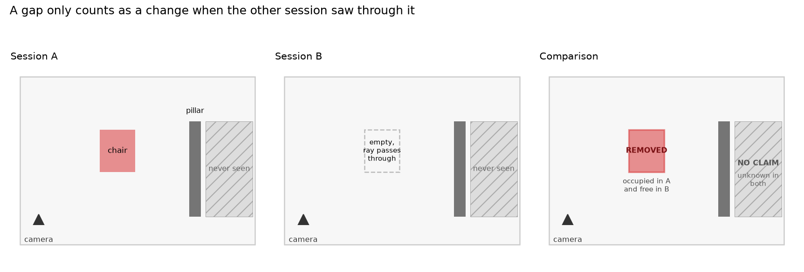
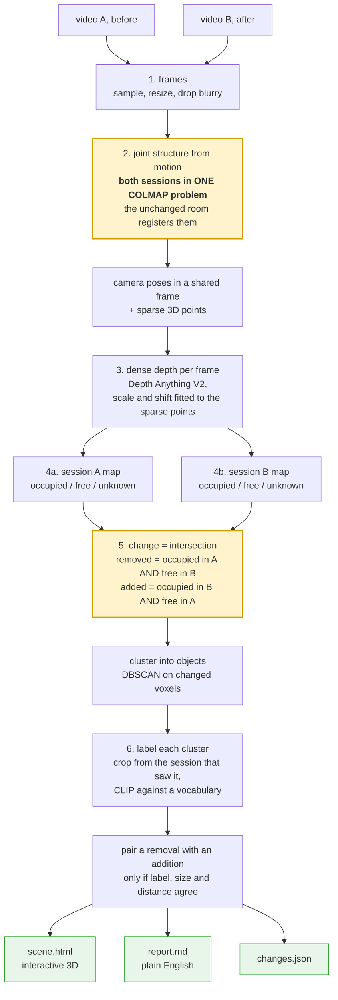
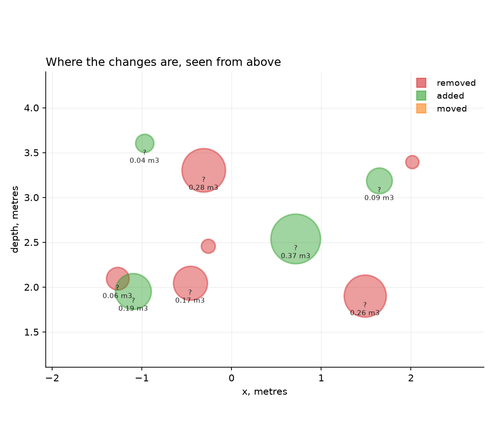
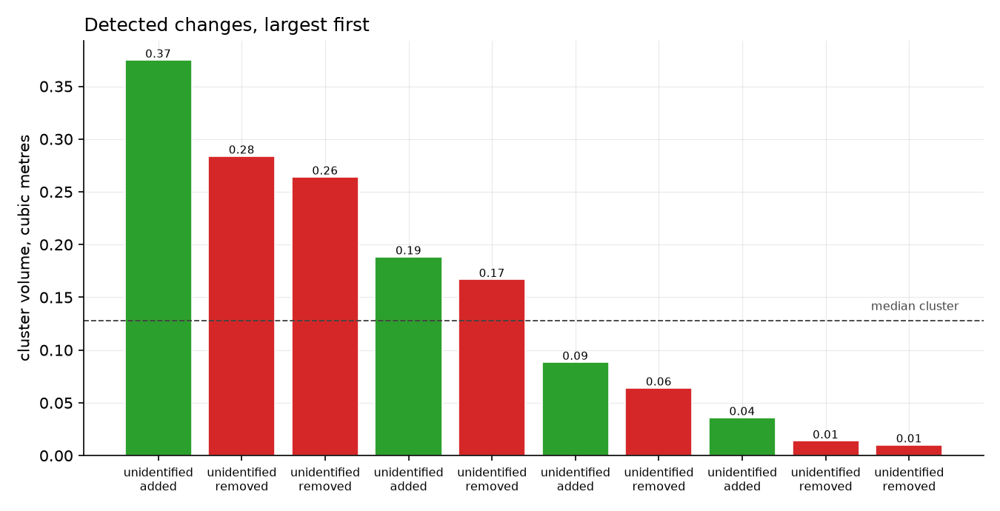

# What Changed in the Room?

Film a room. Move some things. Film it again. This tells you what moved, what
appeared and what is gone, where it happened in 3D, and what the objects were.

```bash
python run.py --a videos/before.mp4 --b videos/after.mp4 --out output/
```

You get an interactive 3D view of the room with the changes picked out, a
written summary, and a JSON file of the findings.

> A chair moved. It was in the centre on the left side and is now towards the
> back on the right side, about 2.4 m away.
>
> A cardboard box was removed from the centre on the right side. It occupied
> about 0.27 m3, and that space is now observed to be empty.

---

## The problem is not detecting difference, it is detecting change

Point two cameras at the same room on different days and almost everything looks
different. You stood somewhere else, you held the phone at a different angle,
you walked a different route, things got hidden behind other things.

A system that compares two point clouds will report all of that as change. The
hard part is not noticing that something is different. It is being sure that a
gap means **the object left** rather than **I did not look there this time**.

Two decisions deal with that.

### Both recordings are reconstructed as a single problem

Every frame from both videos goes into one COLMAP reconstruction with exhaustive
matching, rather than reconstructing each video and aligning the results.

The parts of the room that did not change are visible in both recordings, so
COLMAP matches across the session boundary by itself and both sets of camera
poses come out in one coordinate frame. There is no registration step to get
wrong.

This matters because point cloud registration is least reliable exactly when
part of the scene has genuinely moved, which is the only case this project
cares about. Here the unchanged scene does the aligning and the changes are left
as the unknown, which is the right way round.

### Space is tracked as empty, not just as full

Each session is stored as an occupancy map with three states, not a cloud.

| | |
|---|---|
| **occupied** | depth measurements landed here |
| **free** | a camera ray passed through here on its way to a surface, so this space was looked at and there was nothing in it |
| **unknown** | neither, so nothing can be said |

Then change is an intersection rather than a subtraction:

```
removed = occupied in A  AND  free in B
added   = occupied in B  AND  free in A
```

Both sides need positive evidence from the other session. A voxel that was
occupied in A and simply never observed in B produces nothing at all, because
nothing can honestly be claimed about it.



That is the whole argument. It makes the system conservative: it will miss real
changes in parts of the room only one pass covered. That is the right failure
for anything a robot is going to navigate with. Saying "a doorway is clear"
because nobody looked at it is worse than saying nothing.

---

## How it works



The two highlighted steps are the ones that matter. Everything else is
plumbing.

Monocular depth is dense but affine-invariant, so it has no idea of scale. The
sparse COLMAP points are the fix: they are in the same frame from the same
camera, so fitting a scale and shift onto them drops the dense depth into
COLMAP's coordinate system. The fit is done in inverse-depth space, where the
relationship is linear.

A removal is only ever cropped from a **session A** frame, because by session B
the object is not there. Getting that backwards gives you a confident label for
whatever is sitting in that space now, and output that is wrong while looking
entirely reasonable.

Moves are inferred, never assumed. A removal and an addition are reported as one
move only if they share a semantic label, have comparable volume, and sit within
a sensible distance. Anything that does not pair stays an honest removal or
addition.

---

## Running it

### Install

```bash
pip install -r requirements.txt
```

COLMAP comes in through `pycolmap`, so there is no separate binary to install.
The depth and CLIP models download on first run, about 1 GB in total. It works
on CPU. A GPU makes the depth stage faster but nothing requires one.

### Try it without filming anything

There is a synthetic room with scripted changes, so you can see it work before
recording your own.

```bash
python tools/make_synthetic_room.py --out videos/
python run.py --a videos/before.mp4 --b videos/after.mp4 \
              --out output/ --config config_synthetic.yaml
```

Ground truth for that scene: a chair moves about 2.5 m to the right, a box is
removed, a bag is added, and a table stays put. All four are found, in the right
places and at sensible volumes.





The four real changes are the large bars. Everything under the median line is
depth noise on flat walls, which is the honest cost of monocular depth. Committed output from that run is in
[examples/](examples/), including the 3D scene.

Two honest notes about it. Six smaller false positives also appear, from
monocular depth error on flat walls. And every label comes back as "unidentified
object", because the synthetic objects are cubes covered in coloured noise and
CLIP correctly has no idea what they are. The geometry is what the synthetic
scene validates; the labelling needs a real room. [examples/README.md](examples/README.md)
goes through it.

### Filming your own

Two recordings of the same room, 20 to 60 seconds each.

- **Walk a similar route both times.** The overlap between the two is what links
  them, and it is also the only region where changes can be found.
- **Move slowly.** Motion blur destroys feature matching more than anything else.
- **Keep plenty of unchanged background in shot**, walls, floor, furniture that
  is staying. That is what registers the two sessions.
- **Change a few obvious things**, not everything. If most of the room moves
  there is nothing stable left to align against.
- Avoid filming in the dark or at blank white walls. Texture is what SIFT needs.

```bash
python run.py --a videos/before.mp4 --b videos/after.mp4 --out output/
```

### Output

Example inputs and the outputs they produced are committed in
[examples/](examples/), so you can see both ends without running anything.

| File | What it is |
|---|---|
| `output/scene.html` | interactive 3D. Grey is the unchanged room, red removed, green added, amber moved. Open in a browser and spin it |
| `output/report.md` | the written summary |
| `output/changes.json` | every cluster with its label, centroid, volume and the frame it was labelled from |

### Options worth knowing

| Flag | |
|---|---|
| `--no-semantics` | geometry only, skips CLIP. Much faster when tuning |
| `--config` | point at your own YAML |

Everything is in `config.yaml`, commented. The three that matter:

- `occupancy.voxel_size`, resolution against memory. 0.05 resolves a backpack
- `sfm.max_features`, the biggest lever on runtime, since matching cost grows
  quickly with it
- `semantics.vocabulary`, add the things actually in your room rather than
  letting the model snap them to the nearest word on the list

---

## What it does not do

- **No metric scale.** COLMAP's units are arbitrary, so volumes and distances are
  relative, not metres. A known-size object in shot, or phone ARKit and ARCore
  poses, would fix it.
- **Monocular depth is the weakest link.** Its errors are smooth and plausible,
  which is the worst kind. Dense multi-view stereo would be better where there
  is a GPU.
- **It is conservative by design.** Changes in space only one session covered are
  not reported. See the argument above; this is a choice, not an oversight.
- **A fixed label vocabulary.** CLIP picks the closest entry in `config.yaml`.
  An open-vocabulary detector would name things the list never anticipated.
  Anything scoring near chance is reported as "unidentified object" rather than
  guessed at, and moves are not paired on a label the model was unsure of.
- **It assumes a static scene.** Someone walking through shot will register as
  occupancy. Filming an empty room avoids this.

More on all of this, and why each call was made, in [docs/DESIGN.md](docs/DESIGN.md).

If you want the version that assumes no background at all, including what every
tool does and why it was picked, read [docs/GUIDE.md](docs/GUIDE.md).

---

## Layout

```
run.py                        entry point
config.yaml                   every setting, commented
src/frames.py                 video to frames
src/sfm.py                    joint reconstruction over both sessions
src/depth.py                  monocular depth, fitted to the sparse points
src/occupancy.py              occupied / free / unknown voxel maps
src/changes.py                the set algebra, clustering, move matching
src/semantics.py              CLIP labels from image crops
src/report.py                 3D scene and written summary
tools/make_synthetic_room.py  renders the test scene
tools/make_figures.py         draws the figures above from a finished run
docs/DESIGN.md                design choices and tradeoffs
```

Built by [Ramdas Chaugale](https://github.com/Ramdas-Chaugale).
